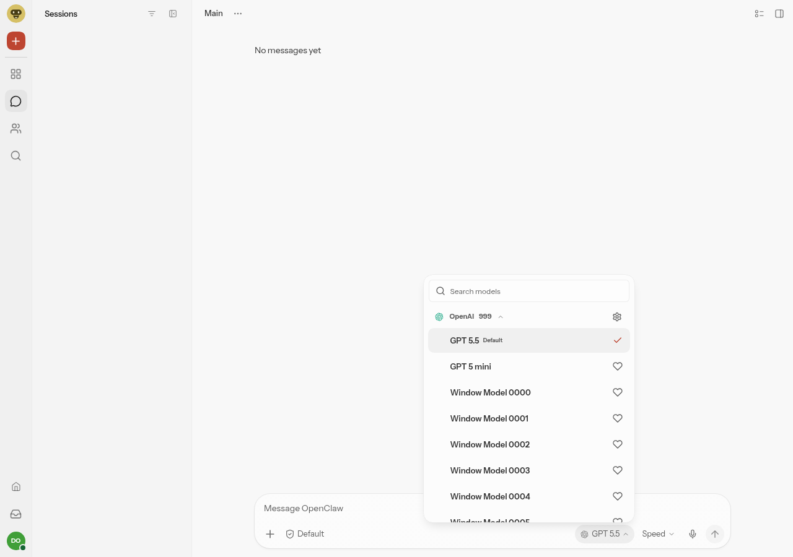
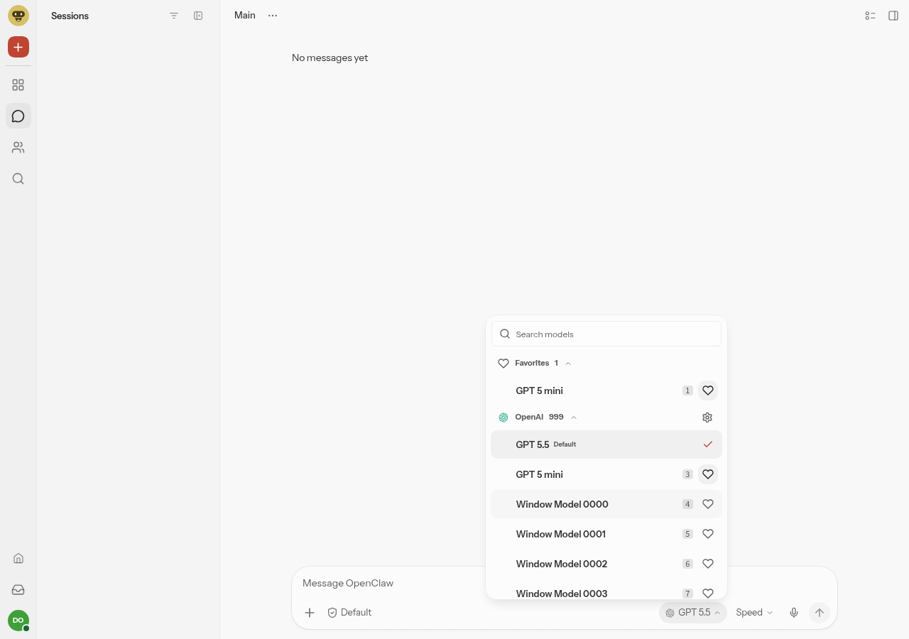

# Favorites current maintenance evidence

Product head `faa1062bccb9546751b74d181e3888359760ec70`, tree `15977ef769df89575379e35e77344b64654d68a5`; normal merge with main `1de61f3e587c3093e57964f1423ba1ad51551b56`. The real composer conflict is resolved without dropping current-main filter, provider, heading or bounded-window rules. Inline hearts now reuse the existing `IconButton` owner; surface CSS only places the button. Preference scope and the human **personal-versus-shared HOLD remain unchanged**.

This is an explicit visual consistency change: the previous filled heart becomes the standard outlined heart with pressed background. Actual composer rendering is a **28px button / 16px glyph / stroke 2** because existing main composer SVG styles override the generic 15px row token. No old 18px or fixed 15px visual parity is claimed.

Normal UI build PASS in 120.328s. Actual built Chromium acceptance PASS in 80.291s (82.412s process), using `node --import ./scripts/tsx.mjs "$ARTIFACTS/favorites-proof.mjs"` from this clean checkout, with the exact checkout/stable/history environment recorded in the [command receipt](favorites-canonical-native-qualified.json). The browser received the normal build's exact index and entry assets; no source server, identity rewrite or rebuild was used for this run.

The real built model picker crosses a synthetic Gateway transport into actual candidate canonical preference workers and durable storage. The unmodified published 2026.11.1 package first writes two synthetic profiles; current production startup/Doctor preserves them. Enter saves a favorite, second-browser and reload readback preserve it, and Space removes it: preference 0→1→0, both released profiles retained, only the documented owner-created migration marker added. Controls: zero `sessions.patch`, distinct favorite/provider row IDs, focus returned before disabled state, zero page errors, and a 1000-model catalog mounting 9 rows initially / 24 after actual wheel scrolling plus offscreen search. [Exact-head receipt, readbacks and hashes](current-faa-receipt.json) · [Frozen collector](favorites-proof.mjs).

The first run stopped before favorite actions at a collector-only fixed 15px assumption. Source and built CSS identified the existing composer 16px cascade; an authorized harness-only correction asserted the actual context tokens while retaining every behavioral control. The [first BLOCKED receipt](first-attempt-blocked-receipt.json) and [qualification](first-attempt-diagnosis.json) are preserved. The product build did not change.

Current-head frames below were visually inspected; both show the new outlined/pressed-background design, not a BASE-red comparison:

[Historical 854 unselected](historical-854-unselected.png) · [Historical 854 selected/filled heart](historical-854-selected.png). These retain their original SHA and are not same-base pixel-parity evidence.

Existing focused favorites/picker/preferences 44 tests PASS in 27.501s; targeted lint 144.420s (including artifact-lock wait), semantic UI types 112.966s, format 0.273s and CSS lint 1.949s PASS. No tests or allocations were added by this maintenance repair.

**Performance remains blocking; this is not merge-ready or CI-green.** Both clean main and candidate normal builds used the same Node 26/package/lock/performance/compression owners; each actual artifact was measured once. The unchanged canonical base-aware evaluator leaves five failures:

| Metric (bytes) | Main 1de | Candidate faa | Paired enforcement limit | Result |
|---|---:|---:|---:|---|
| largest JS gzip | 564,216 | 564,549 | 564,484 | FAIL +65 |
| total CSS gzip | 325,566 | 325,634 | 325,630 | FAIL +4 |
| total CSS raw | 1,676,608 | 1,676,883 | 1,676,672 | FAIL +211 |
| chat boot JS gzip | 1,294,705 | 1,295,038 | 1,294,769 | FAIL +269 |
| new boot JS gzip | 802,982 | 803,315 | 803,250 | FAIL +65 |

Document gzip also exceeds its absolute cap (15,982→16,002B versus 13,893B), but the 20B increase falls within the canonical 64B inherited-base variance. Normal branch/timestamp/buildID differ; document delta is not pure feature attribution. The shared 333B JS increase appears in three overlapping totals and must not be summed. These are local actual artifacts, not new hosted-CI results. No budget was raised. [Paired analysis](favorites-canonical-paired-performance.json) · [actual main metrics](favorites-main-performance.metrics.json) · [actual candidate metrics](favorites-canonical-performance.metrics.json).

Not tested in this run: authenticated live Gateway, WebKit/Safari or physical mobile, dark/RTL/full hover-focus-state matrix, model turn or channel delivery. Test-owned browsers/server/workers stop and isolated private state is removed; no production service/account/session/channel was changed. Technical maintenance and this bounded functional PASS do not resolve the performance failures or the human product HOLD.

